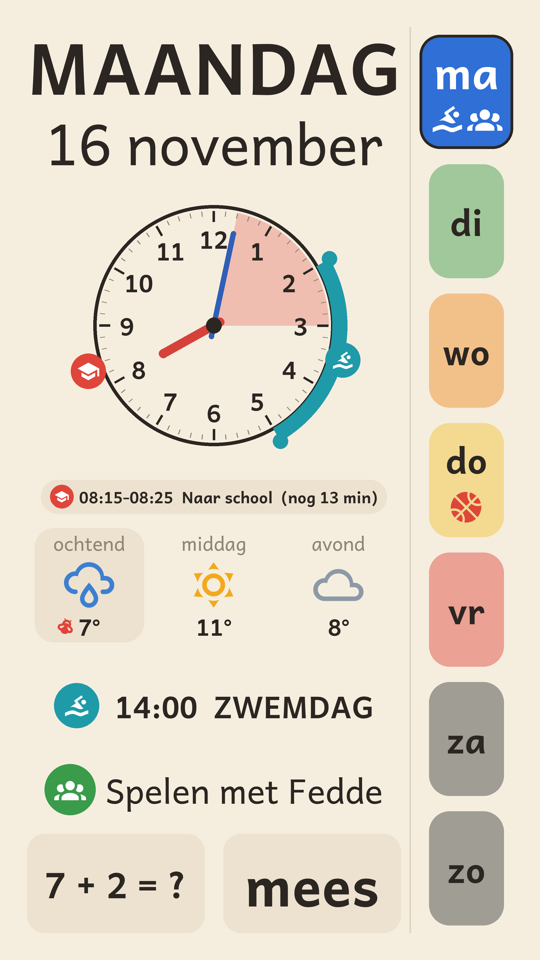

# Frame Dayplanner for Home Assistant

A Home Assistant add-on that turns a Samsung **The Frame** into a day planner
for kids (and the rest of the family), shown in art mode and refreshed every minute.



Modules: day, date, big analog clock (with event arcs), weather for
morning/afternoon/evening, weekly and custom events, holidays, HA calendars
with word filters, a sum and a *klankzuiver* word, a coloured week strip,
labelled time slots on the clock (e.g. *Naar school* with a countdown) and a
figure hidden somewhere new every day.

## Install

1. In Home Assistant go to **Settings → Add-ons → Add-on store**.
2. Click **⋮ → Repositories** and add
   `https://github.com/sandervandenbrakel/ha-frame-dayplanner`.
3. Install **Frame Dayplanner**, set the TV IP address on the
   *Configuration* tab and start it.
4. Open **Dayplanner** in the sidebar → **Connect to TV** → accept on the TV.

Full documentation: [frame_dayplanner/DOCS.md](frame_dayplanner/DOCS.md).

## Development

```bash
python3 -m venv .venv && .venv/bin/pip install -r frame_dayplanner/requirements.txt
.venv/bin/python tools/preview.py            # writes docs/preview_*.png
cd frame_dayplanner && DATA_DIR=/tmp/fd HA_URL=http://homeassistant.local:8123 HA_TOKEN=... \
  ../.venv/bin/python -m app.main            # UI on http://localhost:8099
.venv/bin/python -m unittest discover -s tests
```

## Credits

* [Andika](https://software.sil.org/andika/) font by SIL (OFL), designed for beginning readers
* [Material Design Icons](https://pictogrammers.com/library/mdi/) (Apache 2.0)
* [samsungtvws](https://github.com/xchwarze/samsung-tv-ws-api) for the Frame art API
